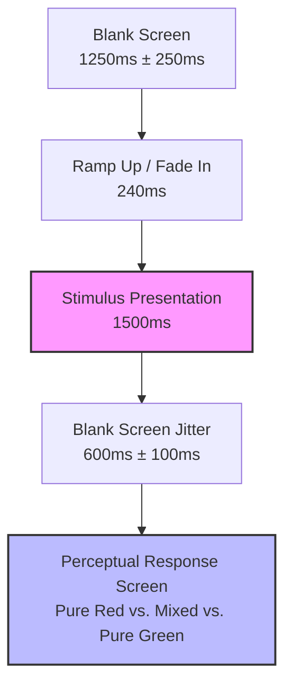
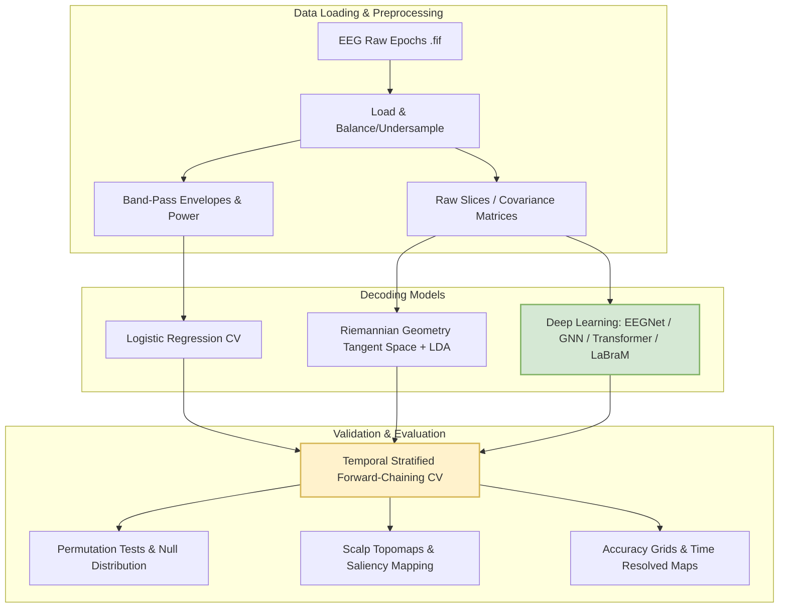

# Binocular Rivalry: Evaluating the Role of Theta Power as a Neural Index of Conflict

This repository contains the source code, analysis pipelines, and Jupyter notebooks for a **Treball de Fi de Grau (TFG)** investigating the neural mechanisms of cognitive conflict and attention in **Binocular Rivalry (BR)** using Electroencephalography (EEG) and Machine/Deep Learning classifiers.

The project builds upon the theoretical framework of conflict monitoring and cognitive control, validating findings from the accompanying research article:  
📄 **[Drew et al., 2026 - Binocular Rivalry: Evaluating the Role of Theta Power as a Neural Index of Conflict](file:///c:/Users/nils/Documents/Universitat/TFG/docs/bibliografia/00_Binocular%20Rivalry%20Evaluating%20the%20Role%20of%20Theta%20Power%20as%20a%20Neural%20Index%20of%20Conflict.pdf)** (Draft located in [00_BR.md](file:///c:/Users/nils/Documents/Universitat/TFG/docs/markdown/00_BR.md)).

---

## 📊 Project Overview & Paradigm

Binocular rivalry (BR) occurs when incompatible images are presented simultaneously to each eye. Rather than merging them into a single 3D scene, the brain undergoes stochastic switches between perceiving one image, the other, or a piecemeal blend (mixed percept) of both. It has been hypothesized that this interocular competition engages the brain's cognitive conflict monitoring system, centered in the **Anterior Cingulate Cortex (ACC)** and reflected by **fronto-medial (fm) theta power (5–7 Hz)**, while the subsequent attentional adjustment and suppression of the rival eye is mediated by **parieto-occipital (po) alpha power (8–12 Hz)**.

To rule out confounding motor preparation and introspection signals associated with continuous reporting protocols, this study utilizes an **Onset Rivalry Protocol** which separates the stimulus perception from the motor report:

### Key Experimental Conditions & Percepts
1. **Congruent Stimuli (C)**: Identical stimuli shown to both eyes (no interocular conflict). Subject reports a **Pure Percept**.
2. **Incongruent Stimuli**: Mutually incompatible stimuli shown to each eye (interocular conflict).
   - **Incongruent Pure (IP)**: Subject reports a **Pure Percept** (indicating successful resolution of the physical conflict).
   - **Incongruent Mixed (IM)**: Subject reports a **Mixed/Piecemeal Percept** (indicating incomplete or transitioning conflict resolution).

### Decoding Tasks
- **Task 1: Congruent vs. Incongruent Pure ($C\text{ vs. }IP$)**: Evaluates conflict monitoring per se. Because both conditions result in the same subjective experience (a pure percept), any differences in neural activity reflect the resolution of physical interocular conflict.
- **Task 2: Incongruent Mixed vs. Incongruent Pure ($IM\text{ vs. }IP$)**: Investigates the neural correlates of successful conflict resolution versus unstable rivalry dynamics.

---

## 🛠️ Analysis & Decoding Pipeline

### 📋 Detailed Model Pipelines

Below is the exact data format, preprocessing steps, and classification setups for each model family in the repository:

#### 1. Logistic Regression (LR_theta / LR_alpha)
* **Input Data**: Raw EEG epochs in `.fif` format (24 subjects, ~200 trials/subject).
* **Preprocessing & Feature Extraction**:
  * **Class Balancing**: Random undersampling per subject to maintain a perfect 50/50 ratio.
  * **Time Windowing**: Cropped time window dynamically adjusted to significant cluster activation (0.375s to 1.242s).
  * **Bandpass Filtering**: FIR bandpass filter (`method="fir", phase="zero-double"`) applied to Theta (5–7 Hz) or Alpha (8–12 Hz) bands.
  * **Spatial Selection**: Subset of electrodes corresponding to frontomedial theta cluster (Fz, FCz) or parieto-occipital alpha cluster.
  * **Feature Calculation**: Average envelope amplitude (Hilbert transform) or average band power.
  * **Feature Scaling**: `StandardScaler` (z-score over all trials/features, train-fit, test-applied).
* **Classifier**: L2-regularized Logistic Regression (`SafeLogisticRegressionCV`) with a 3-fold cross-validation nested loop for grid-searching the regularization parameter $C$.
* **Evaluation**: 5-fold temporal stratified cross-validation.

#### 2. Riemannian Geometry (Riemann TS-LDA)
* **Input Data**: Raw EEG epochs in `.fif` format.
* **Preprocessing & Feature Extraction**:
  * **Class Balancing**: Random undersampling per subject to maintain a perfect 50/50 ratio.
  * **Time Windowing**: Cropped time window (0.375s to 1.242s).
  * **Bandpass Filtering**: FIR bandpass filter (`method="fir", phase="zero-double"`) applied independently to Theta (5–7 Hz) and Alpha (8–12 Hz) bands.
  * **Multi-network Fusion**: Concatenates theta cluster (2 chs) and alpha cluster (27 chs) along the channel axis.
  * **Covariance Estimation**: Oracle Approximating Shrinkage (**OAS**) estimator to compute spatial covariance matrices per trial: $\Sigma_i \in \mathbb{R}^{C \times C}$.
  * **Tangent Space Mapping**: Trial covariance matrices are projected onto the Riemannian Tangent Space at the geometric mean covariance point, yielding flat vector features.
* **Classifier**: Linear Discriminant Analysis (LDA) with LSQR solver and automatic shrinkage (`shrinkage="auto"`).
* **Evaluation**: 5-fold temporal stratified cross-validation.

#### 3. EEGNet (Agnostic vs. Clustering)
* **Input Data**: Raw EEG epochs in `.fif` format.
* **Preprocessing & Feature Extraction**:
  * **Class Balancing**: Random undersampling per subject to maintain a perfect 50/50 ratio.
  * **Agnostic Config**: All 60 EEG channels; full analysis window (0.0s to 1.5s); broad IIR bandpass filter (1.0–40.0 Hz); downsampled/resampled to 128 Hz.
  * **Clustering Config**: Data-driven theta and alpha clusters (29 electrodes); cropped analysis window; IIR bandpass filtered (theta 5-7 Hz, alpha 8-12 Hz) concatenated along the channel axis.
  * **Standardization**: Per-trial and per-channel z-score scaling across the time dimension to ensure amplitude invariance.
* **Model Architecture**:
  * Temporal Conv2D (kernel length=64 for 128Hz, F1=8 filters).
  * Spatial Depthwise Conv2D (group-convolutions with D=2 spatial filters per temporal channel).
  * Spatiotemporal Separable Conv2D (F2=16 filters) to mix features.
  * Average Pooling (1x8), Dropout (0.5), and Fully Connected classification head.
* **Training & Refitting**: AdamW optimizer ($lr=1e-3$, $wd=1e-4$), CrossEntropy Loss with class weights. Trains with a 2-stage automated refit: (1) Trains with $20\%$ validation for early stopping to find $best\_epoch$, (2) resets weights and retrains on $100\%$ training data for exactly $best\_epoch$ epochs.
* **Evaluation**: 5-fold temporal stratified cross-validation.

#### 4. Spatio-Temporal Graph Neural Network (ST-GNN)
* **Input Data**: Raw EEG epochs in `.fif` format.
* **Preprocessing & Feature Extraction**:
  * **Class Balancing**: Random undersampling per subject to maintain a perfect 50/50 ratio.
  * **Bandpass Filtering**: Broad bandpass IIR filtered (4.0–13.0 Hz, covering theta and alpha). Downsampled to 128 Hz.
  * **Graph Node Feature Extraction**: Extracts Differential Entropy (DE) features using Welch PSD log-power over sliding temporal windows ($250\text{ ms}$ window, $50\text{ ms}$ step), producing inputs of shape `(trials, windows, channels, bands)`.
  * **Graph Topology**: Adjacency matrix $A \in \mathbb{R}^{C \times C}$ computed via 3D electrode distance thresholding: $A_{ij} = \exp(-d(i,j)^2 / \sigma^2)$ if distance $d(i,j) < 0.35$.
  * **Standardization**: Z-score standardized per trial, node, and feature over the window/temporal dimension.
* **Model Architecture**:
  * ChebConv spectral graph convolution layers to learn spatial graph structures.
  * 1D Temporal convolution layers to capture temporal transitions.
  * Fully connected layer with dropout.
* **Training & Refitting**: AdamW optimizer ($lr=1e-3$), 2-stage automated refitting.
* **Evaluation**: 5-fold temporal stratified cross-validation.

#### 5. Spatio-Temporal EEG Transformer (ST-EEGFormer)
* **Input Data**: Raw EEG epochs in `.fif` format.
* **Preprocessing & Feature Extraction**:
  * **Class Balancing**: Random undersampling per subject.
  * **Resampling & Filtering**: All 60 electrodes; resampled to 128 Hz; full window (0.0s to 1.5s); IIR bandpassed (1.0–40.0 Hz).
  * **Channel Alignment**: Rearranges the 60 electrode channels to match the 1D sequential spatial layout expected by ST-EEGFormer.
  * **Standardization**: Per-trial and per-channel Z-score scaling.
* **Model Architecture**:
  * Pre-trained ST-EEGFormer backbone.
  * Low-Rank Adaptation (LoRA) injected into the attention layers to allow parameter-efficient transfer learning with small sample sizes ($r=8$, $\alpha=16$).
  * Linear classifier head.
* **Training & Refitting**: AdamW optimizer ($lr=1e-4$), 2-stage automated refitting.
* **Evaluation**: 5-fold temporal stratified cross-validation.

#### 6. Large Brain Model (LaBraM)
* **Input Data**: Raw EEG epochs in `.fif` format.
* **Preprocessing & Feature Extraction**:
  * **Class Balancing**: Random undersampling per subject.
  * **Resampling & Filtering**: All 60 electrodes; resampled to 128 Hz; full window (0.0s to 1.5s); IIR bandpassed (1.0–40.0 Hz).
  * **Sequence Padding**: Edge-padded along time axis to exactly 200 samples (`patch_size=200` turns the 1.5s trial into a single temporal patch).
  * **Standardization**: Per-trial and per-channel Z-score scaling.
* **Model Architecture**:
  * Pre-trained `InterpolatedLaBraM` backbone (spatial interpolation of channels, masked autoencoder pre-training).
  * LoRA injected into attention ("attn") and MLP ("mlp") modules with high regularization ($r=2$, $\alpha=4.0$, $dropout=0.2$, $weight\_decay=1e-2$).
  * Linear classifier head.
* **Training & Refitting**: AdamW optimizer ($lr=3e-5$), 2-stage automated refitting.
* **Evaluation**: 5-fold temporal stratified cross-validation.

---

## 📂 Codebase Structure

The source code is organized into a modular helper library ([src/br_analysis](file:///c:/Users/nils/Documents/Universitat/TFG/src/br_analysis)), utility scripts, and Jupyter notebooks.

### 📓 Jupyter Notebooks (`src/notebooks/`)

* **[01_exploració_dades.ipynb](file:///c:/Users/nils/Documents/Universitat/TFG/src/notebooks/01_exploraci%C3%B3_dades.ipynb)**: Performs initial exploratory analysis of the raw/preprocessed EEG signals, checking sampling frequencies, trial durations, balance of event codes, power spectral density (PSD), and event-related potentials (ERP).
* **[02_classificació_simple.ipynb](file:///c:/Users/nils/Documents/Universitat/TFG/src/notebooks/02_classificaci%C3%B3_simple.ipynb)**: Trains simple machine learning baselines (Logistic Regression, Random Forest, SVM) on raw envelope/power features extracted from fronto-medial theta and parieto-occipital alpha bands.
* **[03_chance_level.ipynb](file:///c:/Users/nils/Documents/Universitat/TFG/src/notebooks/03_chance_level.ipynb)**: Evaluates single-channel and multi-channel band envelope classifiers on the **Congruent vs. Incongruent Pure** task. Runs an epochs grid (evaluating model accuracy as a function of the number of trials) and a time-window map, using permutation shuffles to build empirical null distributions.
* **[04_riemann.ipynb](file:///c:/Users/nils/Documents/Universitat/TFG/src/notebooks/04_riemann.ipynb)**: Implements a decoding pipeline based on Riemannian geometry (covariance matrices projected onto the tangent space, classified using LDA) to distinguish **Congruent vs. Incongruent Pure** trials.
* **[05_visualitzacions.ipynb](file:///c:/Users/nils/Documents/Universitat/TFG/src/notebooks/05_visualitzacions.ipynb)**: Visualizes and compares the classical machine learning models' output, including subject learning curves, accuracy distributions, spatial scalp topographies, and statistical comparisons of classifier performance.
* **[06_chance_level_im_ip.ipynb](file:///c:/Users/nils/Documents/Universitat/TFG/src/notebooks/06_chance_level_im_ip.ipynb)**: Applies the same feature-based decoding grid and permutation-testing pipeline from `03` to classify **Incongruent Mixed vs. Incongruent Pure** trials. *(Paired with `03_chance_level.ipynb`)*.
* **[07_riemann_im_ip.ipynb](file:///c:/Users/nils/Documents/Universitat/TFG/src/notebooks/07_riemann_im_ip.ipynb)**: Applies the same Riemannian covariance and Tangent Space LDA classification pipeline from `04` to classify **Incongruent Mixed vs. Incongruent Pure** trials. *(Paired with `04_riemann.ipynb`)*.
* **[08_clustering.ipynb](file:///c:/Users/nils/Documents/Universitat/TFG/src/notebooks/08_clustering.ipynb)**: Implements data-driven spatiotemporal clustering using cluster-based permutation testing (Maris & Oostenveld, 2007) to identify statistically robust, contiguous groups of electrodes and active time windows for C vs IP and IM vs IP tasks in both Theta and Alpha bands, providing inputs for the focused EEGNet model.
* **[09_EEGNet.ipynb](file:///c:/Users/nils/Documents/Universitat/TFG/src/notebooks/09_EEGNet.ipynb)**: Builds, trains, and evaluates a 2D convolutional network (EEGNet) on the raw EEG trials for the **Congruent vs. Incongruent Pure** classification task in Agnostic and focused Clustering configurations. Features unified environment execution support.
* **[10_ST-GNN.ipynb](file:///c:/Users/nils/Documents/Universitat/TFG/src/notebooks/10_ST-GNN.ipynb)**: Implements and trains a Spatio-Temporal Graph Neural Network using Chebyshev convolutions over the spatial electrode graph to decode **Congruent vs. Incongruent Pure** states. Features unified environment execution support.
* **[11_ST-EEGFormer.ipynb](file:///c:/Users/nils/Documents/Universitat/TFG/src/notebooks/11_ST-EEGFormer.ipynb)**: Trains and evaluates a Spatio-Temporal Transformer (ST-EEGFormer) model with spatial and temporal self-attention to classify **Congruent vs. Incongruent Pure** trials using LoRA adapters. Features unified environment execution support.
* **[12_LaBraM.ipynb](file:///c:/Users/nils/Documents/Universitat/TFG/src/notebooks/12_LaBraM.ipynb)**: Adapts and fine-tunes a Large Brain Model (LaBraM) pre-trained on massive EEG datasets, utilizing Low-Rank Adaptation (LoRA) to perform transfer learning on the **Congruent vs. Incongruent Pure** task. Features unified environment execution support.
* **[13_cross_model_comparison.ipynb](file:///c:/Users/nils/Documents/Universitat/TFG/src/notebooks/13_cross_model_comparison.ipynb)**: Centralizes all cohort-wide cross-model benchmark comparisons across 8 model configurations (Logistic Regressions, Riemannian TS-LDA, EEGNet Agnostic, EEGNet Clustering, ST-GNN, ST-EEGFormer, and LaBraM). Computes global performance distributions, connected subject trajectory tracing, and pairwise Wilcoxon signed-rank significance matrix heatmaps with Benjamini-Hochberg FDR correction.
* **[14_explainability.ipynb](file:///c:/Users/nils/Documents/Universitat/TFG/src/notebooks/14_explainability.ipynb)**: Centralizes spatial and temporal feature attribution analyses for the **Congruent vs. Incongruent Pure** task. Computes backpropagation saliency mappings and SHAP gradient explanations side-by-side for ST-GNN, ST-EEGFormer, and LaBraM.
* **[15_EEGNet_im_ip.ipynb](file:///c:/Users/nils/Documents/Universitat/TFG/src/notebooks/15_EEGNet_im_ip.ipynb)**: Applies the EEGNet classification pipeline to decode **Incongruent Mixed vs. Incongruent Pure** trials.
* **[16_ST-GNN_im_ip.ipynb](file:///c:/Users/nils/Documents/Universitat/TFG/src/notebooks/16_ST-GNN_im_ip.ipynb)**: Applies the Spatio-Temporal Graph Neural Network classification pipeline to decode **Incongruent Mixed vs. Incongruent Pure** trials.
* **[17_ST-EEGFormer_im_ip.ipynb](file:///c:/Users/nils/Documents/Universitat/TFG/src/notebooks/17_ST-EEGFormer_im_ip.ipynb)**: Applies the ST-EEGFormer LoRA fine-tuning pipeline to decode **Incongruent Mixed vs. Incongruent Pure** trials.
* **[18_LaBraM_im_ip.ipynb](file:///c:/Users/nils/Documents/Universitat/TFG/src/notebooks/18_LaBraM_im_ip.ipynb)**: Applies the LaBraM LoRA fine-tuning transfer learning pipeline to decode **Incongruent Mixed vs. Incongruent Pure** trials.
* **[19_cross_model_comparison_im_ip.ipynb](file:///c:/Users/nils/Documents/Universitat/TFG/src/notebooks/19_cross_model_comparison_im_ip.ipynb)**: Centralizes all cohort-wide cross-model benchmark comparisons for the **Incongruent Mixed vs. Incongruent Pure** task.
* **[20_explainability_im_ip.ipynb](file:///c:/Users/nils/Documents/Universitat/TFG/src/notebooks/20_explainability_im_ip.ipynb)**: Centralizes spatial and temporal feature attribution analyses (Saliency and SHAP) for the **Incongruent Mixed vs. Incongruent Pure** task.

---

### 🐍 Python Modules (`src/br_analysis/`)

* **[__init__.py](file:///c:/Users/nils/Documents/Universitat/TFG/src/br_analysis/__init__.py)**: Exposes public utilities, configurations, and loaders for importing into the notebooks.
* **[config.py](file:///c:/Users/nils/Documents/Universitat/TFG/src/br_analysis/config.py)**: Centralizes configuration constants, dataset directory detection, targeted channel/frequency clusters (e.g., fronto-medial theta channels, parieto-occipital alpha channels), and defines the decoding task specifications ([ProjectPaths](file:///c:/Users/nils/Documents/Universitat/TFG/src/br_analysis/config.py#L8-L34), [BinaryTaskConfig](file:///c:/Users/nils/Documents/Universitat/TFG/src/br_analysis/config.py#L37-L53)).
* **[datasets.py](file:///c:/Users/nils/Documents/Universitat/TFG/src/br_analysis/datasets.py)**: Handles loading, unit corrections (to Volts), filtering, and balanced class undersampling of MNE EEG epochs (`.fif` files) into structured arrays. It includes custom safeguards to copy Google Drive network-mounted data locally to prevent Windows I/O latency bottlenecks.
* **[deep.py](file:///c:/Users/nils/Documents/Universitat/TFG/src/br_analysis/deep.py)**: Provides PyTorch-specific raw EEG epoch data loading, channel resampling, and spatial distance-based adjacency matrix generation for Graph Neural Network training. *(Paired with `datasets.py`)*.
* **[experiments.py](file:///c:/Users/nils/Documents/Universitat/TFG/src/br_analysis/experiments.py)**: Houses execution routines for classical ML pipelines. It implements a custom forward-chaining cross-validation strategy ([temporal_stratified_splits](file:///c:/Users/nils/Documents/Universitat/TFG/src/br_analysis/experiments.py#L94-L139)) to avoid temporal leakage, permutation-based surrogate null distributions, and a background thread-driven [ProgressTracker](file:///c:/Users/nils/Documents/Universitat/TFG/src/br_analysis/experiments.py#L21-L56) showing high-resolution progress updates for parallel subject training.
* **[features.py](file:///c:/Users/nils/Documents/Universitat/TFG/src/br_analysis/features.py)**: Defines feature transformers for classical classifiers, including the [HilbertMeanEnvelope](file:///c:/Users/nils/Documents/Universitat/TFG/src/br_analysis/features.py#L10-L17) extraction and [MeanPower](file:///c:/Users/nils/Documents/Universitat/TFG/src/br_analysis/features.py#L20-L25).
* **[models.py](file:///c:/Users/nils/Documents/Universitat/TFG/src/br_analysis/models.py)**: Configures scikit-learn models. Features a [SafeLogisticRegressionCV](file:///c:/Users/nils/Documents/Universitat/TFG/src/br_analysis/models.py#L13-L50) class that adjusts cross-validation splits dynamically or falls back to standard logistic regression to handle subjects with highly skewed or low trial numbers, alongside the [RiemannLdaModelFactory](file:///c:/Users/nils/Documents/Universitat/TFG/src/br_analysis/models.py#L85-L100).
* **[plotting.py](file:///c:/Users/nils/Documents/Universitat/TFG/src/br_analysis/plotting.py)**: Exposes functions to plot subject-wise learning curves, aggregate classification accuracy distributions with correct fractional coordinate alignments, MNE-based spatial topomaps of model weights or saliencies, and attention heatmaps.
* **[torch_models.py](file:///c:/Users/nils/Documents/Universitat/TFG/src/br_analysis/torch_models.py)**: Defines the deep learning architectures used for decoding. Contains [EEGNet](file:///c:/Users/nils/Documents/Universitat/TFG/src/br_analysis/torch_models.py#L11-L60) (a compact temporal-spatial convolutional network), [STGNNChebConv](file:///c:/Users/nils/Documents/Universitat/TFG/src/br_analysis/torch_models.py#L93-L135) (a Spatio-Temporal Graph Neural Network using Chebyshev convolutions), and [STEEGFormerLoRA](file:///c:/Users/nils/Documents/Universitat/TFG/src/br_analysis/torch_models.py#L318-L387) (a Spatio-Temporal Transformer with custom LoRA adapters).
* **[pretrained.py](file:///c:/Users/nils/Documents/Universitat/TFG/src/br_analysis/pretrained.py)**: Provides configuration specifications, pre-trained backbone loading utilities, and helper functions to inject Low-Rank Adaptation (LoRA) adapters into linear layers. *(Paired with `torch_models.py`)*.
* **[torch_training.py](file:///c:/Users/nils/Documents/Universitat/TFG/src/br_analysis/torch_training.py)**: Implements training and validation loops, temporal splits, model checkpointing, ROC/PR curves visualization, and classification metrics calculation for the PyTorch deep learning models.

---

### 🎨 Manim Visualizations (`src/scripts/`)

* **[br.py](file:///c:/Users/nils/Documents/Universitat/TFG/src/scripts/br.py)**: A Manim mathematical animation script which generates high-quality schematic video visualizations of the binocular rivalry trial timeline, stimulus representations (Gabor gratings, mirror goggles), congruent/incongruent setups, and pure vs. mixed percept reporting options.

---

## 📈 Scientific Findings Summary

### 1. Fronto-Medial Theta (5–7 Hz) as a Neural Index of Conflict
* **Conflict Modulation**: Fronto-medial (fm) theta power is significantly higher during the 500–1000 ms time window for incongruent pure (rivalrous) trials than for congruent (non-rivalrous) trials. This occurs despite the elimination of motor reporting confounds, supporting the hypothesis that fm-theta acts as a direct neural index of cognitive/sensory conflict.
* **Pure vs. Mixed Dynamics**: Contrary to the initial exploratory prediction, theta power is significantly higher in incongruent pure trials than incongruent mixed trials, indicating that pure percept selection reflects a robust conflict resolution process.

### 2. Parieto-Occipital Alpha (8–12 Hz) and Attentional Suppression
* **Attentional Engagement**: Parieto-occipital alpha power is suppressed (lower power) during incongruent pure trials compared to congruent trials, indicating increased attentional engagement and active suppression of the rival eye to resolve sensory competition.

### 3. Explainability & Spatial Topographies Convergence
* **Spatial Saliency & SHAP Consistency**: Across GNN Chebyshev graph convolutions and Multi-Head Self-Attention layers in pre-trained transformers, both backpropagation saliency mappings and SHAP (`shap.GradientExplainer`) feature attributions converge on similar spatial and temporal profiles.
* **Sensor Importance Map**: Group-level t-tests (masked at $p_{\text{FDR}} < 0.05$) reveal that the models heavily rely on fronto-medial sensor locations (e.g., Fz, FCz, Cz) in the theta band, and parieto-occipital sensor locations (e.g., POz, Oz) in the alpha band during the key conflict resolution window, mirroring the biological findings of Drew et al.
