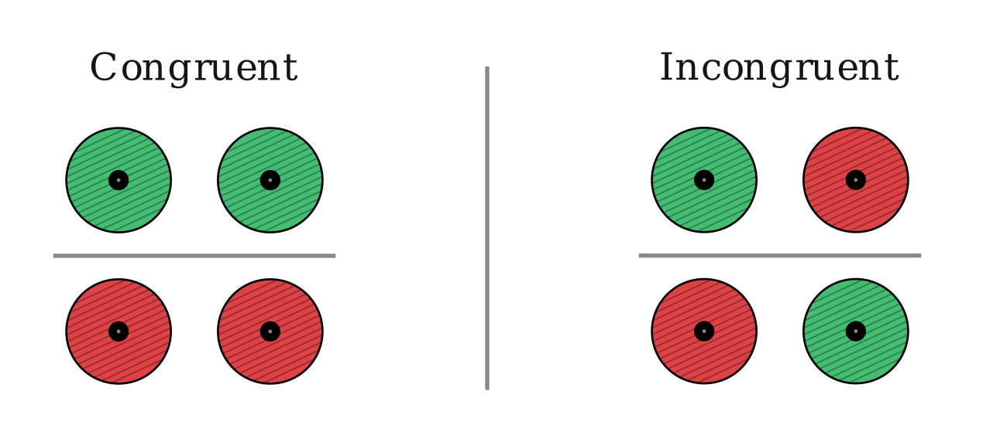
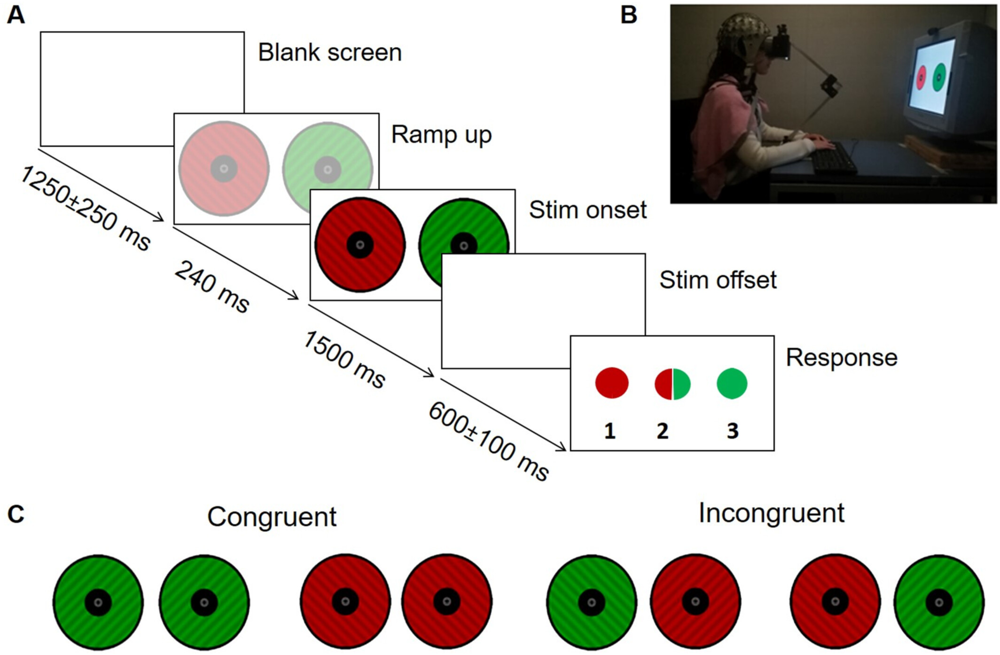
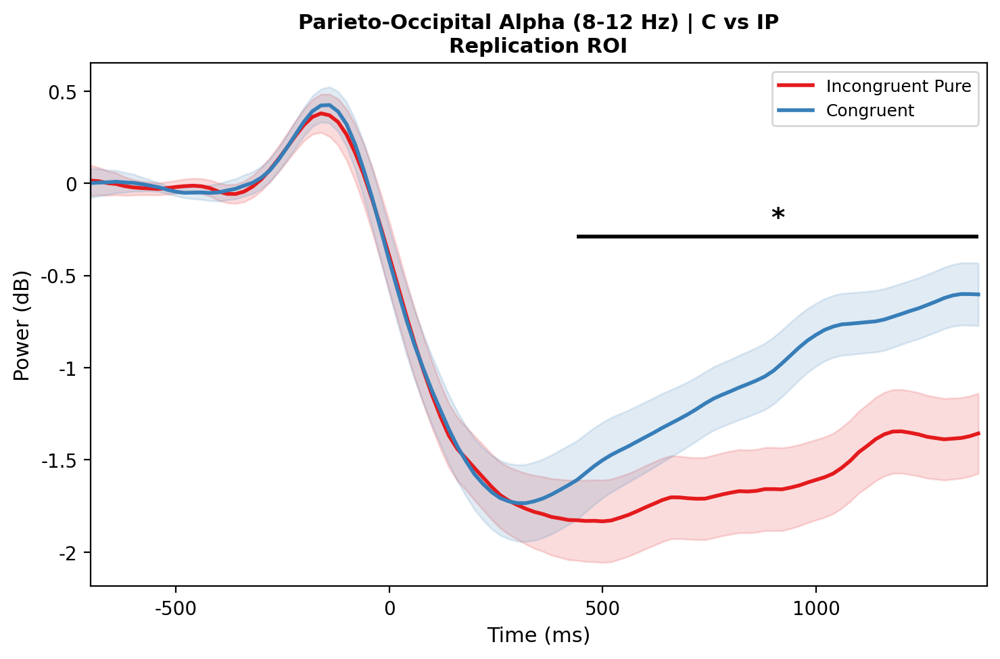
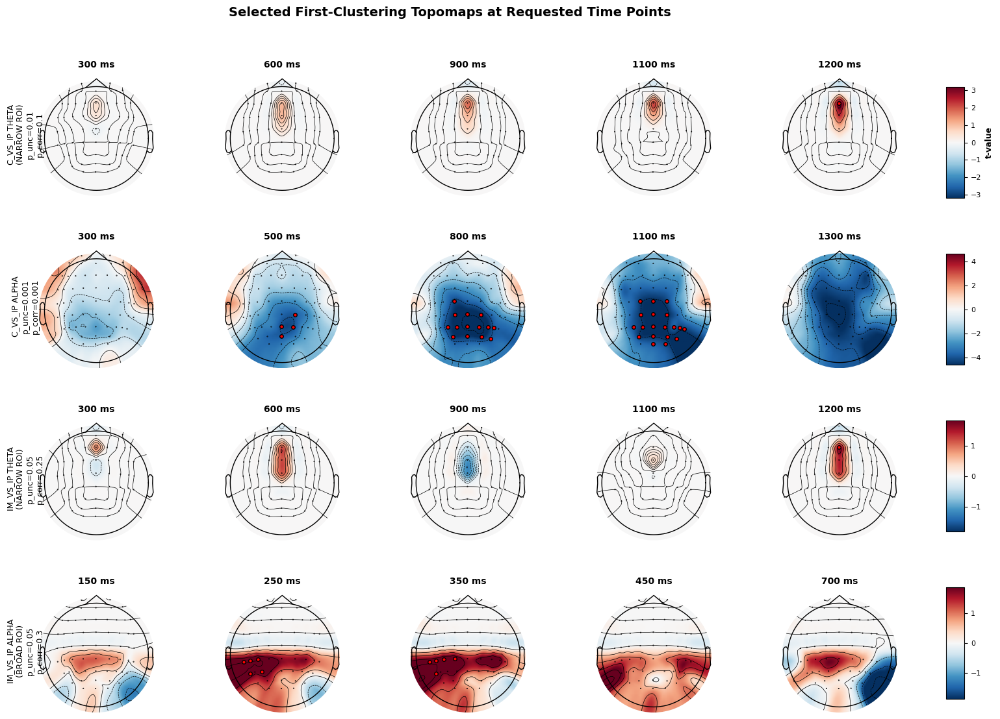
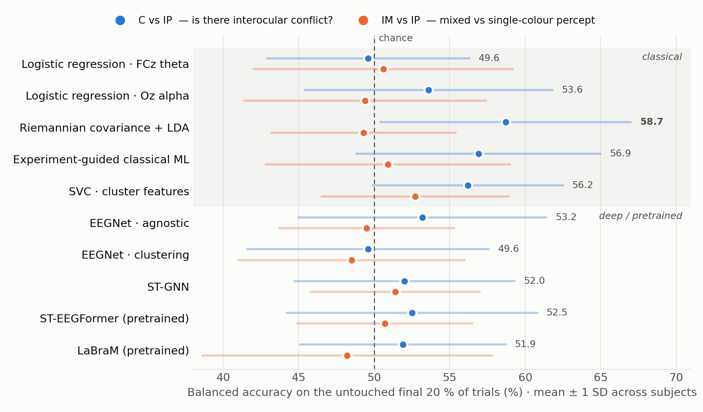
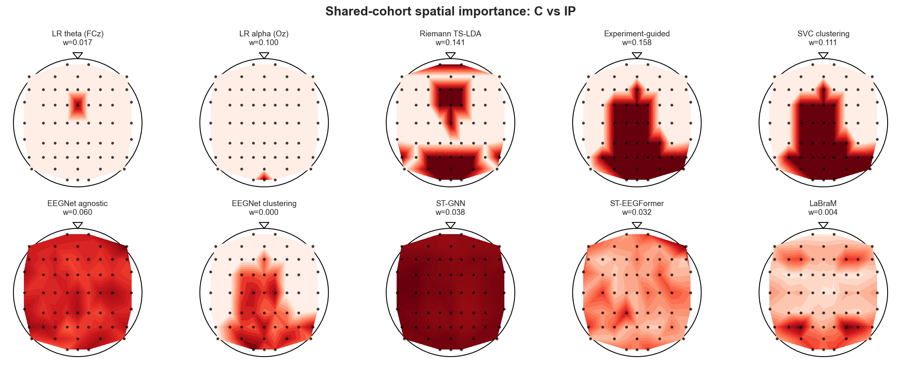
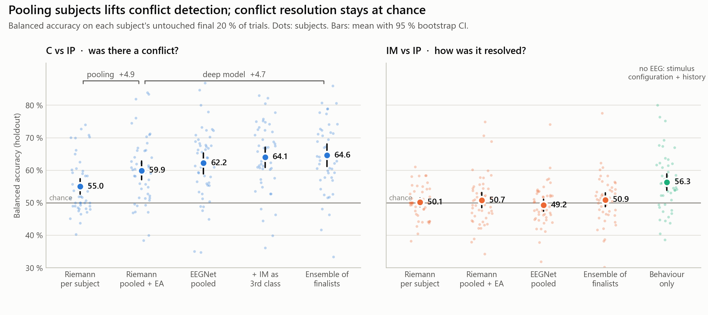
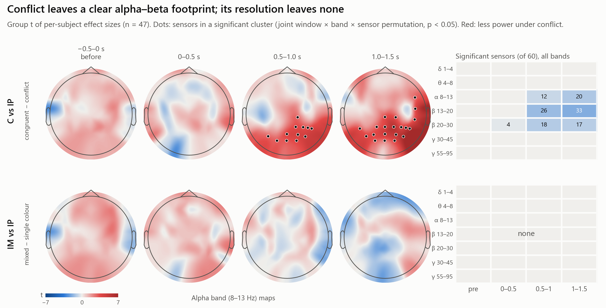
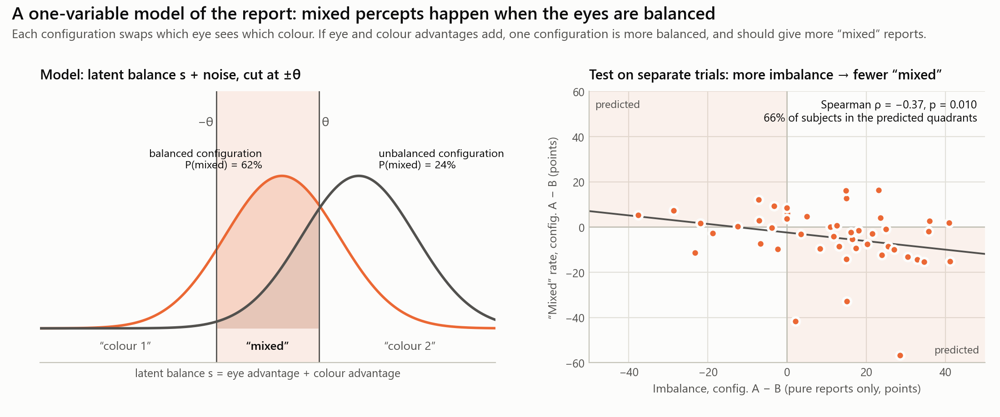
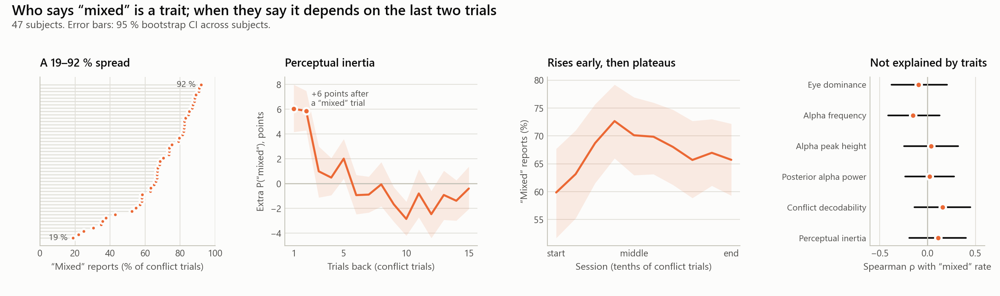

<div align="center">

# Can we read perceptual conflict from a single EEG trial?

**Artificial Intelligence for Cognition: Decoding Cognitive Conflict and Conscious Perception from EEG**

Bachelor's thesis · Artificial Intelligence degree · FIB, Universitat Politècnica de Catalunya · June 2026<br>
Nils Durán Laplaza · supervised by Adrià Tauste and Mireia Torralba

[📄 Read the thesis](TFG.pdf) · [🎬 Watch the explainer video](media/videos/br/1080p60/BinocularRivalryEnglish.mp4) · [🛠️ Usage guide](docs/usage.md)


</div>

---

Show your left eye a **red** disc and your right eye a **green** one, and your brain does not see a
neat yellow blend. It *picks*: you see red, then green, or a patchy mix of the two. This is
**binocular rivalry**. The image on the retina stays the same while conscious perception changes,
which makes it a useful window into how the brain settles a conflict between its inputs.

This thesis asks whether that conflict leaves a trace that a machine-learning model can detect
**in a single 1.5-second EEG trial**, without averaging hundreds of trials first.

<p align="center">
  
</p>

## TL;DR

| | |
|---|---|
| 🧠 **Data** | 47 participants, 60-channel EEG at 500 Hz, about 22,800 onset-rivalry trials ([Drew et al., 2026](https://doi.org/10.1111/ejn.70372); [open data on OSF](https://osf.io/f9gez/overview)) |
| 🎯 **Main result** | Single-trial EEG separates **congruent from conflicting** stimulation above chance. Best model: **Riemannian covariance + LDA, 58.7 % balanced accuracy** on a held-out final 20 % of each session |
| 🌀 **Harder question** | Telling **mixed from single-colour** percepts during conflict stays close to chance (best 52.7 %). Treated as exploratory |
| 🏗️ **Model lesson** | Bigger is not better here. A covariance matrix and a linear classifier match or beat EEGNet, a graph neural network and two pretrained EEG foundation models |
| 🔬 **Neuroscience** | Replicates the **posterior alpha** effect of the original study and extends 1-D temporal clusters to **2-D channel × time clusters** |
| 🔐 **Privacy** | The same recordings identify *who* the participant is with **>98 % accuracy**, so EEG should be handled as biometric data |

## The experiment

Participants looked through a mirror stereoscope, so each eye received its own image. On every
trial a red or green Gabor disc faded in and stayed on screen for 1.5 s. Only after it disappeared
did the participant report what they saw: **red**, **green** or **mixed**.

<p align="center">
  
  <br><sub>Trial structure of the onset-rivalry task (figure from Drew et al., 2026).</sub>
</p>

Combining what was **shown** with what was **reported** gives three labels and two questions:

| Label | Stimulus | Report | | Task | Question |
|---|---|---|---|---|---|
| **C** · Congruent | same colour in both eyes | one colour | | **C vs IP** | Does the EEG know there was a conflict, even when the report looks the same? |
| **IP** · Incongruent-Pure | different colours | one colour | | **IM vs IP** | Given a conflict, can the EEG predict how it was resolved? |
| **IM** · Incongruent-Mixed | different colours | mixed | | | |

**C vs IP** is the cleaner test. Both classes end in the same kind of report, so a decoder cannot win
by detecting "the participant pressed the *mixed* button". Only the presence of interocular conflict
differs.

## Results

### 1 · Replication: the alpha effect is there

Power in the parieto-occipital **alpha band (8–12 Hz)** stays more suppressed after conflicting
stimuli than after congruent ones, from about 450 ms until the stimulus ends. This matches the
original paper. The fronto-medial **theta** effect is weaker and depends more on the analysis choices.

<p align="center">
  
</p>

### 2 · From time courses to channel × time clusters

Instead of fixing a region of interest in advance, cluster-based permutation tests run over **all
channels and time points**, with family-wise error control. The C vs IP alpha effect grows into a
broad posterior cluster (*p*<sub>FWER</sub> = 0.001). The IM vs IP clusters are weaker and less
stable across subjects, as measured by subject-to-group Jaccard divergence.

<p align="center">
  
</p>

### 3 · Single-trial decoding: ten models, one honest split

Every model is trained per subject on the **first 80 % of the session**, with hyperparameters chosen
by blocked, grouped cross-validation inside that period. Each model is then scored **once** on the
**final 20 %**, which no model sees before that point. Classes are balanced inside training folds
and all metrics are balanced accuracy, so 50 % is chance.

<p align="center">
  
</p>

<details>
<summary><b>Table of the same numbers</b></summary>

| Model | C vs IP | IM vs IP |
|---|---:|---:|
| Logistic regression, FCz theta | 49.6 ± 6.7 | 50.6 ± 8.6 |
| Logistic regression, Oz alpha | 53.6 ± 8.2 | 49.4 ± 8.0 |
| **Riemannian covariance + LDA** | **58.7 ± 8.3** | 49.3 ± 6.1 |
| Experiment-guided classical ML | 56.9 ± 8.1 | 50.9 ± 8.1 |
| SVC, cluster features | 56.2 ± 6.3 | **52.7 ± 6.2** |
| EEGNet, agnostic | 53.2 ± 8.2 | 49.5 ± 5.8 |
| EEGNet, cluster-restricted | 49.6 ± 8.0 | 48.5 ± 7.5 |
| ST-GNN | 52.0 ± 7.3 | 51.4 ± 5.6 |
| ST-EEGFormer (pretrained) | 52.5 ± 8.3 | 50.7 ± 5.8 |
| LaBraM (pretrained) | 51.9 ± 6.8 | 48.2 ± 9.6 |

Balanced accuracy (%) on the final chronological holdout, mean ± SD across subjects.

</details>

**Why does a decade-old covariance model beat transformers?** The effect is weak, spread across many
channels and different from subject to subject, and each subject contributes only a few hundred
trials. A shrinkage-regularised covariance matrix projected to the Riemannian tangent space keeps
exactly that distributed cross-channel structure with very few parameters. The larger models have
more capacity than the data can constrain. The cluster-based SVC result also needs a caveat: the
clusters were found on the same data, so its score may be optimistic.

### 4 · What do the models look at?

SHAP attributions, computed only on held-out trials, show that the stronger classical models focus
on **posterior and frontal sites**, in line with the alpha and theta literature. Most deep models
spread their importance across the whole scalp.

<p align="center">
  
</p>

### 5 · A privacy warning

A subject-identification control, using the same pipeline with participant identity as the label,
recognises the participant from a held-out trial with **more than 98 % accuracy**. EEG carries a
strong personal fingerprint. This is also why random trial-level splits are dangerous: a model can
score well by recognising the person or the session instead of the condition.

## Takeaways

> **Science:** conflict-related perceptual information *is* present in single-trial scalp EEG, but it
> is subtle, distributed and sensitive to how it is validated.
>
> **Method:** for small, noisy, subject-specific EEG datasets, a model whose assumptions fit EEG
> (covariance geometry, compact EEG-specific convolutions) matters more than model size.
> Preprocessing, representation and an honest validation split matter as much as the architecture.

## After the thesis: a stricter re-analysis

The code in this repository was refactored after submission to remove the remaining analyst degrees
of freedom.

- **All 47 subjects** are included. There is no effect-size-based subject selection and no
  undersampling.
- Every model goes through **one shared preprocessing cache, split protocol and artifact format**.
- **Four extra tasks** are added (three-class C/IP/IM, red vs green, and more), together with
  **temporal decoding onset** using max-T correction and holdout confirmation, and **inter-subject
  transfer** with Euclidean Alignment.

Under this stricter protocol, Riemannian TS-LDA still leads C vs IP with **55.0 ± 8.3 %**, and EEGNet
is close behind at 54.9 %. IM vs IP stays at chance for every model. The ranking holds and the
effect is smaller, which is expected once the subject selection used in the thesis is removed.

### Follow-up research (this branch)

Same protocol, same stimulus window (0–1.5 s), same untouched 20 % holdout per subject. Full notes are in
[docs/post_tfg_research.md](docs/post_tfg_research.md) (in Catalan). The figures are generated by
`python -m br_analysis.research.post_figures`.

**Decoding.** Training **one model on all subjects** (Euclidean Alignment, then per-subject
fine-tuning) lifts C vs IP from 55.0 % to **64.6 %**. About half of the gain comes from pooling alone:
the same Riemannian pipeline trained on everyone reaches 59.9 %. The other half comes from deep
models found by a successive-halving GPU screen of about 40 configurations. The best single change
is adding the IM trials as a third training class. A pretrained foundation model (CBraMod) does not
help. IM vs IP stays at chance for every model. A stimulus-only behavioural baseline (eye–colour
configuration + response history) beats them all.

<picture>
  <source media="(prefers-color-scheme: dark)" srcset="docs/images/post_tfg/fig1_decoding_ladder_dark.png">
  
</picture>

**Where is the conflict, and where is its resolution?** Conflict produces a robust drop in posterior
alpha and beta power from about 0.5 s onwards. This replicates the thesis and the original study, and
it survives one joint permutation test over windows, bands and sensors. The same test finds
**nothing** for mixed versus single-colour percepts, in any band or window, before or during the
stimulus. The evoked responses overlap too, apart from a small, uncorrected parietal difference
around 1.0 s ([figure](docs/images/post_tfg/fig5_erp.png)).

<picture>
  <source media="(prefers-color-scheme: dark)" srcset="docs/images/post_tfg/fig2_spectral_maps_dark.png">
  
</picture>

**A computational account of the report.** Conflict trials come in two configurations that swap
which eye sees which colour. A one-variable ordered model works as follows: a latent balance, equal to
the eye advantage plus the colour advantage, is cut at ±θ. The model predicts more "mixed" reports in
whichever configuration is better balanced. Tested on separate trials (balance estimated from the
pure reports only), the prediction holds: Spearman ρ = −0.37, p = 0.010, with 66 % of subjects in
the predicted direction. The model does not capture everything, though: it misfits 9 of 47 subjects.

<picture>
  <source media="(prefers-color-scheme: dark)" srcset="docs/images/post_tfg/fig3_balance_model_dark.png">
  
</picture>

**Behaviour.** Reports carry **perceptual inertia**: after a "mixed" trial, the next two conflict
trials are about 6 points more likely to be "mixed" than a drift-preserving shuffle predicts
(p < 10⁻⁶). The mixed rate also climbs during the first third of the session and then levels off.
The large spread between people (19–92 %) is *not* explained by eye dominance, individual alpha
frequency, alpha power, or how decodable their conflict signal is (all |ρ| < 0.16).

<picture>
  <source media="(prefers-color-scheme: dark)" srcset="docs/images/post_tfg/fig4_behaviour_dark.png">
  
</picture>

**Bottom line.** Scalp EEG carries a clear, decodable signature of *whether* the eyes disagree, but
almost none of *how* the disagreement is resolved. What predicts the resolution is behavioural:
which eye gets which colour, and what the person reported a moment ago. Decoding the percept itself
would probably need a different design, such as frequency tagging (SSVEP), no-report measures, or
more trials per person.

## Repository layout

```text
src/br_analysis/        Python package: data loading, preprocessing, tasks, models, runners,
                        statistics (clustering, temporal onset), SHAP, reports and CLI
  runners/              shared training loops for classical and PyTorch models
  research/             follow-up benchmark, pooled training and IM vs IP exploration
gpu/                    pooled deep models and the Kaggle screening notebook
src/notebooks/          12 narrative notebooks (EDA → clustering → models → explainability → report)
tests/                  78 pytest tests (leakage-safe splits, metrics, runners, caches, CLI)
animations/             Manim scenes behind the explainer video
docs/images/            figures used in the thesis and this README
docs/usage.md           full technical guide: CLI, caches, Kaggle GPU runs, artifact format
TFG.pdf                 the thesis
```

## Quick start

```powershell
python -m venv .venv
.venv\Scripts\activate
python -m pip install -e ".[deep,explain,dev]"
```

Place the preprocessed epochs as `P0XX.fif` files in `data/` (the original recordings are on
[OSF](https://osf.io/f9gez/overview)), and then run:

```powershell
br-analysis validate-data                          # check files and event codes
br-analysis prepare-data                           # build the shared preprocessing caches once
br-analysis run --task c_vs_ip --model riemann     # train and evaluate one model
br-analysis run --task all --model all --jobs 4    # fill the full task × model matrix
br-analysis report                                 # artifacts/report/index.html
```

Every notebook calls the same runners, so the CLI and the notebooks produce identical artifacts.
See the **[usage guide](docs/usage.md)** for preprocessing presets, the methodology checklist,
temporal-onset and inter-subject analyses, cloud GPU runs and the artifact format.

## Data and citation

The EEG data and the original analysis code come from:

> Drew, A., San-Segundo González, J., Soto-Faraco, S. & Torralba-Cuello, M. (2026). *Binocular Rivalry: Evaluating the Role of Theta
> Power as a Neural Index of Conflict.* European Journal of Neuroscience, 63.
> [doi:10.1111/ejn.70372](https://doi.org/10.1111/ejn.70372) · data: [osf.io/f9gez](https://osf.io/f9gez/overview)

If you use this code, please cite the thesis:

```bibtex
@thesis{duran2026binocular,
  author = {Durán Laplaza, Nils},
  title  = {Artificial Intelligence for Cognition: Decoding Cognitive Conflict and Conscious Perception from EEG},
  school = {Facultat d'Informàtica de Barcelona, Universitat Politècnica de Catalunya},
  type   = {Bachelor's thesis},
  year   = {2026},
  url    = {https://github.com/nilsduran/TFG}
}
```
